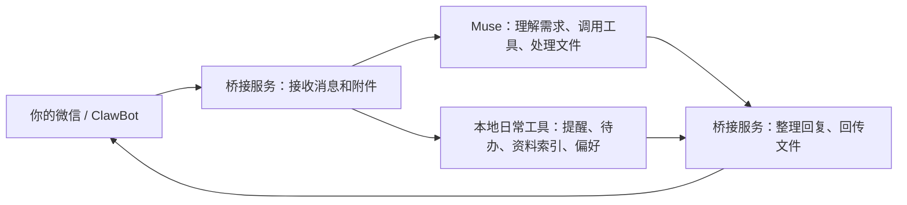

# 微信 × Muse 桥接

**把 Muse 接进微信，支持文字、图片、微信语音、视频和文件附件：在手机上提需求，让它处理资料，再把回答和文件发回微信。**

[](https://github.com/6688dong/wechat-muse-bridge-public/actions/workflows/ci.yml)
[](docs/DEPLOY.md)
[](LICENSE)

部署完成后，你在微信的 ClawBot 对话里发文字、图片、语音、视频或文件，桥接服务会把内容交给
你已登录的 Muse 处理，再把回答和生成的文件送回微信。你可以在手机上提出需求、
补充要求、接收文件；负责调用 Muse 的服务在 Linux 环境中持续运行。

例如：发截图让它识别内容，发语音描述需求，发视频让它分析抽样画面；发一份 Excel，
让 Muse 汇总金额并返回修改后的表格；发 PDF 整理要点；生成文档，或设置“10 分钟后提醒我开会”。
文件会作为真正的微信附件回传，
微信正文只呈现结果，不展示服务器保存路径。

[功能一览](#功能一览) · [使用示例](#实际怎么用) · [快速部署](docs/DEPLOY.md) · [日常命令](docs/DAILY_TOOLS.md) · [家人绑定](docs/MULTI_ACCOUNT.md) · [排错](docs/FAQ.md)

> 本项目源码公开，项目自有材料采用 **PolyForm Noncommercial 1.0.0 非商业许可**。
> 商业用途需另行授权；内置 SDK 保留 MIT。完整范围见 [许可说明](#许可与第三方声明)。

## 功能一览

| 功能 | 输入或操作 | 能得到什么 |
| --- | --- | --- |
| 文字对话 | 在微信里直接提问、补充要求 | Muse 的回答，以及任务生成的可用文件 |
| 图片理解 | 发照片、截图、含文字的图片 | 图像内容说明、文字整理；依赖 Muse 图像工具 |
| 语音需求 | 发微信语音 | 转写后的需求交给 Muse，结果以文字或生成文件回复 |
| 视频分析 | 发短视频并说明关注内容 | 3 帧抽样画面的分析，尝试加入音轨转写；声音端到端实测待完成 |
| 文件阅读与修改 | 发 Excel、Word、PDF、PPTX 等附件 | 内容总结、数据整理或修改后文件；依赖 Muse 对应文件工具 |
| 文件与图片回传 | 要求生成文档、表格、图片或其他文件 | 图片按图片发送，其他产物按文件附件发送，正文不暴露服务器路径 |
| 资料找回 | 最近文件、文件名搜索、编号重发 | 本人索引中的资料列表，以及仍可用的历史文件 |
| 提醒与待办 | 创建、列表、取消、完成 | 持久保存的事项和到时提醒，主动发送需有效微信上下文 |
| 长任务进度 | 处理耗时较长的任务 | 自动进度通知；明确失败的普通任务可手动重试 |
| 个人偏好 | 设置长短、格式、索引开关 | 按本人保存的回复偏好和新文件索引设置 |
| 家人连接 | 为每人创建连接并独立扫码 | 分开的 Muse 对话、登录态、任务、附件和日常工具数据 |

输入类型受桥接支持，具体内容的理解和生成效果取决于 Muse 及已安装工具。
下面按场景展开用法、交付形式和限制。

## 适合什么场景

- **手机上处理资料**：在微信里发送文档、表格、截图，把读取、整理和修改交给 Muse。
- **让处理结果回到微信**：收到总结，也收到可下载、可打开的生成文件，方便继续查看或转发。
- **找回之前的文件**：查询近期收发资料、按名称搜索，重新发送仍然可用的附件。
- **管理日常事项**：记录待办、设置一次性提醒，在微信里查询或取消。
- **给家人使用**：共用一套 Muse 服务，各自扫码绑定微信，分开保存对话和附件。
- **需要可维护的常驻服务**：提供安装、服务管理、备份、升级、回滚和验收文档。

使用者日常通过微信操作；部署者需要有 Linux 环境和可用的 Muse 账号。
Muse 的回答质量、可调用工具及文件处理能力由实际 Muse 环境决定。

## 实际怎么用

下面展示的是请求方式和预期交付形式，不是完整实测聊天记录。
文件内容、识别质量和回复耗时以实际环境为准；已验证范围见 [验收摘要](FINAL-REPORT.md)。

### 1. 发一个文件，让它读取、修改，再把文件发回来

**你发送**：一份 Excel 附件，再补充需求：

> 把这份表格按月份汇总金额，增加一个汇总页，把修改后的 Excel 发给我。

**它完成**：Muse 读取实际附件并按要求处理；桥接把生成的表格作为微信文件附件回传，
同时发一段可读的结果说明。你可以继续提出修改要求。

也可以请求：

> 把这份 Word 文档整理成一页摘要，生成新的文档发给我。  
> 总结这份 PDF 的主要内容，把其中的表格整理出来。  
> 根据这份资料整理演示文稿，并把文件发给我。

本项目负责附件收发和任务衔接；读取、编辑及生成具体格式需要 Muse 环境具备对应工具。
已有 Excel、Word、文本 PDF、PPTX 处理与返回样本，不代表任意版式或复杂文件都能正确处理。

### 2. 不上传文件，直接让它生成一个文件

**你发送**：

> 生成一个下周的学习计划，做成文档发给我。

**它完成**：把需求交给 Muse；生成成功且文件可用时，微信收到真实附件。
文字任务也支持回传文件，不要求先上传原文件。

Muse 环境有相应生成工具时，也可以要求生成图片。常见图片格式按微信图片发送，
其他产物按文件附件发送；一次任务可以返回多个文件，并分别记录发送结果。

首次部署可用一个很小的请求确认文件通路：

> 生成一个只写着测试的小 txt 文件发给我。

### 3. 发图片、扫描 PDF、语音或视频

| 你发送的内容 | 可以怎样提问 | 实际处理方式与边界 |
| --- | --- | --- |
| 图片、截图 | “这张图在讲什么？”“把图里的文字整理出来” | 下载图片交给 Muse，结果依赖其图像读取能力 |
| 扫描 PDF | “识别这份扫描件，核对金额并整理表格” | 由 Muse 环境读取扫描页；已有可辨中文扫描样本，质量受清晰度和工具影响 |
| 微信语音 | 用语音描述一个需求 | 优先使用微信提供的转写；没有转写时尝试本地识别，再交给 Muse |
| 视频 | “概括这段视频画面，指出可辨认的文字” | 抽取 3 帧画面供分析，画面抽样范围最多前 120 秒，并尝试提取音轨转写 |

视频采用画面抽样；它不能据此保证理解完整连续动作。
**视频清晰人声的微信端到端验收仍待完成**，不能把已通过的画面样本当作声音也已通过。
本地语音识别可能误识别数字、人名；没有可用转写工具时会报告语音转写不可用。

**图片示例**：发一张报错截图，问“这是什么问题？把排查步骤列给我”；
发一张含文字的照片，问“提取可辨认的文字，按列表整理”。结果由 Muse 的图像工具完成。

**语音示例**：发一段微信语音说“帮我把周末采购需要的东西整理成清单”。
桥接优先使用微信转写，没有转写时尝试本地识别，把文字需求交给 Muse；
回答以文字或生成文件回到微信。本地识别结果会标注可能存在错误。

**视频示例**：发一段短视频，问“概括画面里出现的内容，整理可辨认的文字”。
桥接抽取视频开头附近、中段和末段附近的 3 帧供 Muse 分析，并尝试转写音轨。
超过 120 秒的视频，画面取样只覆盖前 120 秒。声音识别要另装工具，并完成实际验收。

语音、视频需要按 [安装指南](docs/DEPLOY.md) 配置相应外部工具。
提醒和待办请先使用下面的文字命令，便于核对事项确实已创建。

### 4. 找回文件，省去重新上传

**你发送**：

```text
最近文件
找文件 报告
再发文件 1
把昨天那份表格再发我
```

**它完成**：列出本人资料索引中的候选文件，包括名称、日期、大小和编号；
按编号把仍可用的文件重新发回微信。存在多个候选时先列出选择，不猜测你指的是哪一份。

这里查询的是该连接已建立的文件索引，关键词按文件名搜索。
文件已删除、旧任务缺少归属信息或关闭索引期间未记录的资料，可能需要重新上传。

### 5. 设置提醒和待办

**提醒**：

```text
提醒我10分钟后 开会
提醒我 明天上午9点 交报告
提醒列表
取消提醒 1
```

创建成功会先回复“已设置提醒”；到期后，后台尝试把提醒发到本人微信。
时间按北京时间解释，模糊或过去的时间会要求澄清或拒绝创建。
后台约每 30 秒检查一次，到时消息可能有调度延迟。

**待办**：

```text
待办 买牛奶
待办列表
完成 1
取消待办 1
```

待办用于记录、查询和完成事项；需要到时通知的事项请使用提醒命令。
事项保存在对应连接的数据库中。主动提醒依赖微信可用的会话上下文；
上下文失效时可能需要本人发一条新消息后补送。新环境必须实测一次设置和到时提醒。

### 6. 长任务有进度，也能调整回复方式

较长的普通任务会自动发送处理中通知。超过约 10 秒开始提示，后续约在 90 秒、
240 秒提示并节流；任务结束后停止进度通知，不猜测完成时间。

明确失败或超时的普通任务，可发送 `重试最近失败任务`。
如果发送结果不明确，需先核对微信是否已经收到，系统不会盲目重复投递。
原附件无法验证时会要求重传。

偏好可直接设置：

```text
偏好 简短
偏好 详细
偏好 列表
偏好 纯文本
偏好查看
偏好 索引关
```

偏好按账号和发送者保存。`索引关` 只停止记录新的文件索引，
保留已有资料、任务记录及 Muse 服务端历史。完整命令见 [日常工具](docs/DAILY_TOOLS.md)。

## 家人能一起用吗

可以创建多个微信连接。每位家人使用自己的微信扫码，每个连接单独配置一个 Muse 对话，
分别保存微信登录态、任务数据库、文件目录、提醒、待办和偏好。

例如：你使用默认连接，家人使用 `family` 连接；两人在各自微信里提问并接收结果。
安装方式见 [多账号配置](docs/MULTI_ACCOUNT.md)。

**共用 Muse 账号仍共享其权限和费用。** 对话和目录分开保存，不等于账户级权限隔离。
需要独立 Muse 权限时，应使用独立 Muse 账号与运行环境。

## 它怎样工作



Muse 负责理解普通需求及处理资料；桥接服务负责微信收发、附件下载、必要的媒体预处理、
任务进度、发送回执和独立连接管理。提醒、待办等固定文字命令由桥接的本地工具处理。

任务和发送记录保存在本地 SQLite 中；文字分段及各个附件分别记录回执。
暂时性附件下载错误有有限重试；发送状态不明确时保留待核对记录，避免重复发送。
服务模板支持异常退出后自动重启；登录失效或上游网络故障仍需按 [排错文档](docs/FAQ.md) 处理。

## 部署前需要什么

| 条件 | 用途 |
| --- | --- |
| 可常驻运行的 Linux 环境 | 运行桥接服务及保存配置、任务和附件 |
| Node.js ≥ 22.13、npm | 运行桥接、安装依赖和构建内置 SDK |
| 已登录且可用的 muse-cli | 使用自己的 Muse 服务，创建专属于连接的对话 |
| 可用的微信扫码 / ClawBot 入口 | 绑定实际使用者的微信 |
| ffmpeg / ffprobe（按需） | 视频抽帧、音轨提取和音频预处理 |
| faster-whisper 与模型（按需） | 微信没有提供语音转写时的本地识别、视频音轨转写 |
| LibreOffice（按需） | 回传 Excel 前的公式重算；其他文件工具取决于 Muse 环境 |

源码包不包含 Muse 账号、微信账号或登录凭据。Muse 服务的权限、费用和访问条件由实际账号决定。
本项目主要提供已有 Muse 环境的微信入口；部署脚本负责安装桥接，后续还需填写配置、扫码并启用服务。

## 开始部署

```bash
git clone https://github.com/6688dong/wechat-muse-bridge-public.git
cd wechat-muse-bridge-public
export REPO="$(pwd)"
bash scripts/deploy.sh default
```

接着按 [安装指南](docs/DEPLOY.md) 完成：

1. 核对服务用户下的 muse-cli 已登录，创建一个连接独占的 Muse 对话。
2. 填写运行配置中的程序路径、对话编号和绑定用户信息。
3. 用实际使用者的微信扫码，启用配置好的后台服务。
4. 从手机测试文字回复、可打开的文件附件，以及 1 分钟提醒的到时实收。

默认运行目录为 `$HOME/wechat-muse-bridge/bridge`。
已有部署更新前先看 [升级与回滚](docs/UPGRADE.md)；服务显示活跃不能代替微信实收验收。

## 验证到什么程度

| 范围 | 当前证据 |
| --- | --- |
| 微信回传生成文件 | 两套独立部署均有用户确认的真实 txt 附件实收 |
| 到时提醒 | 一套同步后部署已确认设置回复及到时提醒实收 |
| Excel / Word / 文本 PDF / PPTX | 有既有样本，未在每次同步后重测所有格式 |
| 扫描 PDF / 视频画面 | 已有对应样本验证，不能推及所有扫描件或视频 |
| 视频清晰人声 | 本地转写已检查，微信端到端验收仍待完成 |
| 资料找回 / 待办 / 进度 / 偏好 | 主要由代码回归覆盖，不能等同完整手机实测 |
| 自动化检查 | 60 项回归；公开发布版本在 GitHub 的 Node 22、24 构建和测试通过 |

新增账号、新环境或运行代码变更后，需要单独完成手机测试。
具体方法见 [验收指南](docs/ACCEPTANCE.md)，已有范围见 [公开验收摘要](FINAL-REPORT.md)。

## 文档与运维入口

| 你要做什么 | 阅读入口 |
| --- | --- |
| 安装桥接、配置语音和视频工具 | [安装指南](docs/DEPLOY.md) |
| 给家人再绑定一个微信 | [多账号配置](docs/MULTI_ACCOUNT.md) |
| 查询日常命令和限制 | [日常工具](docs/DAILY_TOOLS.md) |
| 处理无回复、无附件、提醒未到 | [常见问题](docs/FAQ.md) |
| 更新、备份和回滚 | [升级与回滚](docs/UPGRADE.md) |
| 核对微信实际收到的内容 | [验收指南](docs/ACCEPTANCE.md) |
| 交给支持 skill 的助手维护 | [运维 skill](skills/wechat-muse-bridge/SKILL.md)，需完整仓库与环境权限 |
| 参与修改或报告问题 | [贡献指南](CONTRIBUTING.md) · [安全说明](SECURITY.md) |
| 查看发布变化 | [更新记录](CHANGELOG.md) · [版本下载](https://github.com/6688dong/wechat-muse-bridge-public/releases) |

运维 skill 包含安装、家人连接、升级、回滚和验收步骤，可供支持 skill 的助手读取。
它是运维说明，使用时仍需完整桥接源码、可用账号及运行环境权限。

## 开发与仓库结构

```text
bridge/      桥接入口、配置示例及内置 weixin-agent-sdk
scripts/     部署、扫码、添加连接、验证及回滚工具
docs/        安装、使用、升级、排错和验收说明
skills/      可复用的桥接运维 skill
tests/       回归检查
```

本地验证：

```bash
cd bridge
npm ci
npm run build
npm test
```

依赖与构建产物在安装时生成。配置、cookie、微信登录态、数据库、附件、日志及备份
只保留在受控运行环境中；提交问题前请脱敏，详见 [安全说明](SECURITY.md)。

## 许可与第三方声明

项目自有代码、脚本、测试和文档采用 [PolyForm Noncommercial 1.0.0](LICENSE)，
允许许可条款规定的个人及其他非商业用途，商业用途需要相关权利人另行授权。
这是非商业源码许可，不属于 OSI 定义的开源许可。

内置 `weixin-agent-sdk` 及其本地修改采用 MIT，
原作者版权声明和 [完整 MIT 文本](bridge/vendor/weixin-agent-sdk/LICENSE) 保留。
项目许可不会改变第三方材料的独立许可；完整边界及依赖声明见
[NOTICE](NOTICE) 和 [第三方声明](THIRD_PARTY_NOTICES.md)。

本项目是独立桥接工具，微信、Muse 及 SDK 作者没有为本项目提供官方背书。
